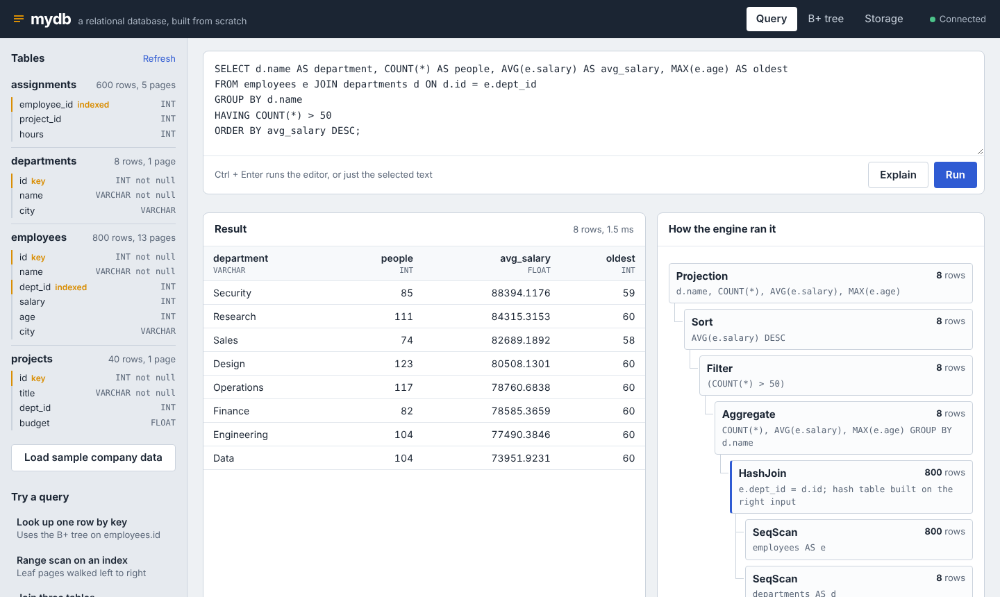

# mydb

A relational database built from scratch in C++17: slotted-page storage, a buffer pool, B+ tree indexes, a SQL parser, a rule-based optimizer, and a Volcano-style executor. It ships with a web console that shows how the engine runs each query.



## Quick start (Windows)

You need CMake and a C++17 compiler (MinGW-w64 or Visual Studio).

```powershell
cmake -S . -B build -G "MinGW Makefiles"     # or omit -G to use Visual Studio
cmake --build build
.\build\mydb.exe
```

Open **http://localhost:8080** and click **Load sample company data**. Then pick a query from the list on the left.

`mydb.exe` options:

| Option | Default | Meaning |
| --- | --- | --- |
| `--data DIR` | `data` | where table and index files are stored |
| `--http N` | `8080` | web console and HTTP API port |
| `--port N` | `5433` | binary protocol port, used by `mydb_client` |
| `--host ADDR` | `127.0.0.1` | listen address (use `0.0.0.0` to accept other machines) |
| `--web DIR` | `web` | web console files |

There is also a terminal client: `.\build\mydb_client.exe` (end statements with `;`, `\q` quits).

Run the tests with `ctest --test-dir build`.

## What's implemented

### Storage
- **Pages:** fixed 4 KB pages, with one file per table (`data/<table>.tbl`) and one per index (`data/<table>.<col>.idx`).
- **Slotted pages:** the slot directory grows from the front of the page and rows from the back. Deleted slots are reused, and a page is compacted when it fragments.
- **Buffer pool:** each file has its own pool of frames, with pin counts, dirty flags, O(1) LRU eviction and hit/miss counters.
- **Heap file:** keeps a free-space map so inserts don't scan every page. Rows are addressed by RID (page, slot).
- **Catalog:** saved to `data/catalog.meta` after every DDL statement, so the schema survives a restart.

### Indexes
- **B+ tree** on INT columns:
  - one node per page;
  - leaves are linked for range scans;
  - duplicate keys are supported;
  - page 0 records the root, so the tree can be reopened after a restart.
- **Automatic primary key index:** an `INT PRIMARY KEY` gets an index automatically, and that index enforces uniqueness.
- **Kept in sync:** every index is updated on INSERT, UPDATE and DELETE.

### SQL
```sql
CREATE TABLE t (id INT PRIMARY KEY, name VARCHAR NOT NULL, price FLOAT, active BOOL);
CREATE INDEX ON t (other_int_col);        DROP INDEX ON t (other_int_col);
DROP TABLE [IF EXISTS] t;                 SHOW TABLES;      DESCRIBE t;
INSERT INTO t [(cols)] VALUES (...), (...);
UPDATE t SET col = expr [WHERE ...];      DELETE FROM t [WHERE ...];
SELECT [DISTINCT] exprs | * | t.*
  FROM a [alias] [JOIN b ON ...] [, c]
  [WHERE ...] [GROUP BY ...] [HAVING ...] [ORDER BY ... [ASC|DESC]] [LIMIT n];
EXPLAIN SELECT / UPDATE / DELETE ...;
```

- **Expressions:**
  - `AND OR NOT` with SQL three-valued logic;
  - `= != <> < > <= >=` and `+ - * / %`;
  - `IS [NOT] NULL`, `[NOT] LIKE`, `BETWEEN`, `IN (...)`.
- **Aggregates:** `COUNT(*)`, `COUNT([DISTINCT] x)`, `SUM`, `AVG`, `MIN`, `MAX`.
- **Type checking:** values are checked against column types, `NOT NULL` is enforced, and primary keys must be unique.

### Query processing
```
SQL ─Lexer→ tokens ─Parser→ AST ─Planner/Optimizer→ operator tree ─Executor→ rows
```
- **Operators** (`src/operators/`) use the iterator model, with `open() / next() / close()`: SeqScan, IndexScan, Filter, Projection, NestedLoopJoin, HashJoin, Sort, Aggregate (hash), Distinct, Limit, Insert, Update, Delete.
- **Optimizer** (rule-based, `src/query/Optimizer.cpp`):
  - pushes each filter down to its table;
  - picks a B+ tree scan when a predicate compares an indexed column with a constant;
  - uses a hash join for equality joins and a nested-loop join otherwise.
- **Plans:** every query returns the operator tree it ran, with the number of rows each operator produced. `EXPLAIN` shows the tree without running it.

### Server and web console
- **HTTP API**, served by `mydb.exe`:
  - `POST /api/query`
  - `GET /api/schema`
  - `GET /api/index`
  - `GET /api/pages`
  - `GET /api/stats`
- **Web console** (`web/`): a SQL editor, results with the operator tree beside them, a B+ tree view that traces a key search page by page, and a storage view showing page occupancy and buffer pool hit rates.
- **Binary protocol** (port 5433) for `mydb_client`.

## Limitations and roadmap

These are **not** implemented yet:

- **Transactions:** there is no BEGIN/COMMIT/ROLLBACK, no write-ahead log and no crash recovery. Statements run one at a time behind an engine-wide lock. A statement that fails halfway, such as a multi-row INSERT that hits a duplicate key, keeps the rows it already wrote.
- **Concurrency control:** no row-level locking or MVCC.
- **Indexes:** INT columns only. Empty nodes are not merged after deletes ("lazy deletion", as in many real systems).
- **SQL:** no LEFT/RIGHT/OUTER joins, no subqueries, no ALTER TABLE.
- **Optimizer:** rule-based, not cost-based. Joins run in the order written in FROM.
- **Memory:** sorts and hash joins keep their input in memory.

Next steps, in order: a write-ahead log and redo recovery, then two-phase locking, then a cost-based join order using table statistics.

## Project layout

```
src/
  catalog/    types, values, schema, catalog persistence
  storage/    DiskManager, Page, BufferPool, HeapFile, Tuple
  index/      B+ tree
  engine/     Database: owns all files under the data directory
  query/      Lexer, Parser, AST, Expression, Optimizer, Planner, Executor, QueryEngine
  operators/  the iterator-model operators
  server/     HTTP + JSON + API (portable), Winsock networking, binary protocol
  main.cpp
web/          the web console (plain HTML/CSS/JS, no build step)
tools/        terminal client
tests/        unit tests (CTest)
```

## Author

Vinayak Bhumbla
